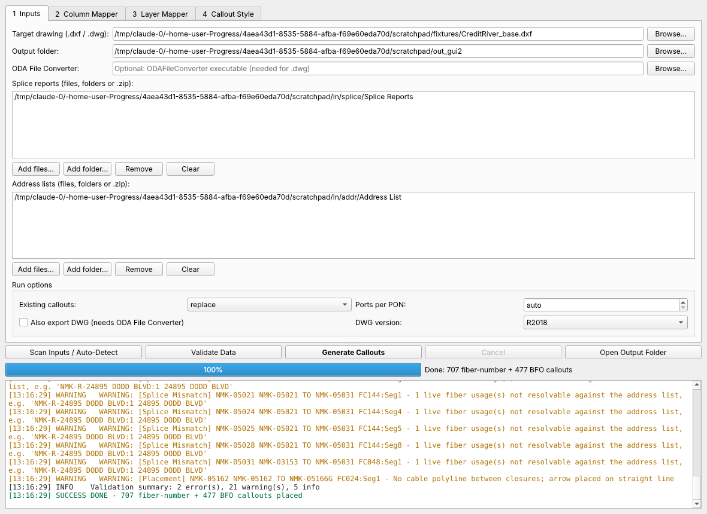

# FTTx Fiber Callout Studio

Desktop tool (PyQt6 + ezdxf + pandas/openpyxl) that generates the **DES_FIBER_SPL fiber-number callouts** of an FTTx
OSP design from its **Splice Reports** and **Address List(s)**, replicating the drafting standard reverse-engineered
from the Credit River (Mediacom NMK) combined DWG — see [docs/PHASE1_REVERSE_ENGINEERING.md](docs/PHASE1_REVERSE_ENGINEERING.md).



## What it produces

| Callout | Rule | Example |
|---|---|---|
| Fiber number (terminal) | `N = (PON − 1) × 64 + PON PORT` per OLM; one MULTILEADER per terminal + drop closure (+ per contiguous run); arrow on the handhole box hosting the drop closure | `12`, `218-219` |
| BFO (cable segment) | for every live cable segment leaving a closure that has a splice report: `BFO <fiber count>\P<min N>-<max N>`; arrow on the cable near the upstream closure | `BFO 144` / `3-90` |

Entities are written exactly like the reference: `MULTILEADER`, layer `DES_FIBER_SPL` (ACI 6, Continuous),
ByLayer color/linetype/lineweight, MLEADER style `Standard`, text style `Standard` (txt.shx), height 4.0, arrow
4.0 closed-filled, dogleg 0.36, landing gap 0.09, left/right attachment 6, top/bottom 9, MText top-left/top-right
by dogleg side.

Outputs (in the output folder):

* `<drawing>_FIBER_CALLOUTS_<timestamp>.dxf` (and `.dwg` when ODA File Converter is available and requested)
* `<drawing>_FIBER_CALLOUTS_QA_<timestamp>.xlsx` — sheets **Summary**, **Callouts** (every callout with tip/landing
  coordinates, anchor, numbers, source calculation e.g. `PON 1 port 12 -> (1-1)*64+12 = 12`, source files, placement
  review flags), **Terminals**, **Cable Segments**, **Validation Issues**, **Existing vs Computed**, **Settings**.

## Setup

Python 3.9 or newer (3.11+ recommended).

```bash
python -m venv .venv
```

Windows:

```bash
.venv\Scripts\activate
```

macOS / Linux:

```bash
source .venv/bin/activate
```

```bash
pip install -r requirements.txt
```

**DWG files:** ezdxf reads/writes DXF natively. For `.dwg` input or `.dwg` output install the free
[ODA File Converter](https://www.opendesign.com/guestfiles/oda_file_converter) and, if it is not on the default path,
point the tool to its executable (Inputs tab → *ODA File Converter*, or `--oda`). Without it, save the drawing as DXF in
AutoCAD (`SAVEAS` → DXF 2018) and open the generated DXF in AutoCAD afterwards.

## Using the GUI

```bash
python fiber_callout_studio.py
```

1. **Inputs** – pick the target drawing, output folder, and add splice reports and address lists (files, folders or
   `.zip` archives; `.xlsx/.xlsm/.xls/.csv`). Choose how existing callouts are handled:
   `replace` (delete existing DES_FIBER_SPL callouts first), `skip` (keep existing, add only missing ones),
   `append`.
2. **Scan Inputs / Auto-Detect** – fills the mappers:
   * *Column Mapper* – PON, PORT, ADDRESS, terminal (`Fiber Tap Name`), drop closure (`Fiber Splice`) … matched by
     synonyms/fuzzy matching; override any field with the drop-downs.
   * *Layer Mapper* – closure layer/block/name tag (matched against closure names in the data), handhole layer and
     blocks, terminal layer, cable layers (linework that meets closures), output layer(s). Terminal callouts can go
     to a separate layer such as `Fiber Number`.
3. **Callout Style** – all dimensions of the standard (defaults = reference values).
4. **Validate Data** – dry run with a live log and progress bar: missing closures, orphan addresses, splice-report
   vs address-list mismatches, unresolved fiber usages, missing geometry, placement problems. Nothing is written.
5. **Generate Callouts** – writes the drawing and the QA/QC workbook. All work runs in a background thread; the window
   stays responsive and **Cancel** stops the job without writing partial output.

## Command line (batch / CI)

```bash
python fiber_callout_studio.py --cli --drawing design.dxf --splice ./SpliceReports.zip --address ./AddressLists --out ./output
```

Pre-flight only (exit code 1 when errors are found):

```bash
python fiber_callout_studio.py --cli --validate-only --drawing design.dxf --splice ./reports --address ./address_lists
```

Show the auto-detected column/layer mapping as JSON:

```bash
python fiber_callout_studio.py --cli --scan-only --drawing design.dxf --splice ./reports --address ./address_lists
```

Project-specific overrides (any subset of `columns`, `cad`, `spec`) — see [config.example.json](config.example.json):

```bash
python fiber_callout_studio.py --cli --config my_project.json --drawing design.dxf --splice ./reports --address ./address_lists --out ./output
```

Other options: `--existing replace|skip|append`, `--ports-per-pon N` (default auto = next power of two ≥ max port),
`--export-dwg`, `--oda <path>`.

## Supported input layouts

* **Address List** — one row per fiber; required: PON, PON PORT, ADDRESS, terminal name, drop splice closure.
  OLM id comes from an OLM column, the sheet name, or an OLM-like token in the file name (`…_NMK-R02_…`).
* **Splice reports** — both layouts found in the Credit River package:
  * *Splice Connections Report* (meta block, Segment/Count/Start Splice/End Splice table, A-cable/B-cable connection
    table with Usage and State);
  * *Fiber Optic Splice Guide* (In/Out segment list `CABLE: SegN-NNct`, per-fiber rows with Hot flag and address).
  Column positions are found by header text, not by fixed index.

## Network model used for placement

* Closures: block references on the closure layer with a name attribute (`MC_SPLICE.dwg` / `NAME`).
* Cable topology: cable polylines are split at every closure they touch (snap tolerance configurable) to build a
  closure graph; a report segment is matched to the polyline leaving its start closure toward its end closure (or,
  for the Splice Guide layout, toward the cable's destination closure).
* Handholes: the nearest configured handhole block within the search radius of the drop closure; the arrow is placed
  on one of its 4 corners / 4 edge midpoints (block extents read from the block definition, so any handhole symbol
  size or rotation works).
* Placement scoring avoids text/text and text/symbol overlap, cable linework under text and leader crossings; any
  callout that still conflicts is flagged `PLACEMENT REVIEW` in the QA workbook.

## Verified on the Credit River design

1,184 callouts generated (reference 1,184): 705/708 terminal and 450/476 BFO texts identical to the hand-drafted
reference, 698/706 terminal arrows on the same handhole and 449/452 BFO arrows on the same cable polyline; every
difference traces to a defect in the reference drawing or the input data and is listed in the QA workbook. Full
evidence: [docs/PHASE1_REVERSE_ENGINEERING.md](docs/PHASE1_REVERSE_ENGINEERING.md#6-validation-of-the-production-tool-against-the-reference).

## Repository layout

```
fiber_callout_studio.py              the application (GUI + CLI + engine, single file)
requirements.txt
config.example.json                  all mapping / style settings with reference defaults
docs/PHASE1_REVERSE_ENGINEERING.md   Phase 1 technical breakdown
docs/img/                            reference-vs-generated renders, GUI screenshot
analysis/                            read-only DWG R2004+ decoder used for the reverse-engineering
```
