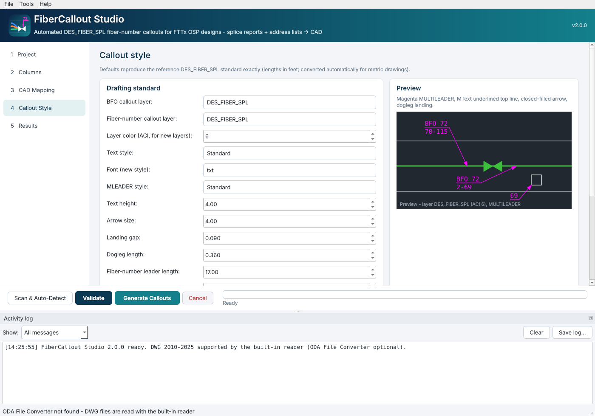

# FiberCallout Studio


Windows desktop app that generates the magenta **DES_FIBER_SPL** fiber-number callouts of an FTTx OSP design from its
**splice reports** and **address lists**, exactly as drafted in the reference design. It works for any region: the
network (closures, handholes, cables, column names, splitter size, units) is detected from the files themselves.


## Download and run (Windows)

1. Download **FiberCalloutStudio-windows-x64** from the repository's *Actions* run (artifact) or *Releases* page.
2. Run `FiberCalloutStudio.exe`. No Python, AutoCAD or other installation is needed. The exe is not code-signed: if
   Windows SmartScreen appears, click *More info -> Run anyway*.
3. Verify the installation: *Tools -> Run built-in self-test* (or `FiberCalloutStudio.exe --selftest`).

## Workflow

| Step | What happens |
|---|---|
| **1 Project** | Pick the design drawing (`.dwg` 2010-2025 or `.dxf`), add splice reports and address lists (files, folders or `.zip`; drag & drop works). |
| **Scan & Auto-Detect** | Fills **Columns** (address-list headers) and **CAD Mapping** (closure block + name attribute, handhole blocks, terminal layer, cable layers, snap tolerance). `(auto-detect)` = decided on every run. |
| **Validate** | Dry run with the full QA: missing closures (with "did you mean" hints), splice-report vs address-list mismatches, orphan addresses, missing cable geometry, placement conflicts. Nothing is written. |
| **Generate Callouts** | Writes the drawing + QA/QC workbook and shows every callout in **Results**. |

Save the settings of a region with *File -> Save project* and reuse them (`--project` on the command line).

## What the callouts are

| Callout | Rule (reverse-engineered, see [docs/PHASE1_REVERSE_ENGINEERING.md](docs/PHASE1_REVERSE_ENGINEERING.md)) | Example |
|---|---|---|
| Fiber number | `N = (PON - 1) x splitter size + PON PORT` per OLM. One callout per terminal + drop closure (per contiguous run). Arrow on the handhole hosting the drop closure. | `69`, `218-219` |
| BFO (cable) | For every cable segment leaving a closure that has a splice report and carries live fibers: `BFO <segment fiber count>` / `<lowest>-<highest> N` of the live (not broken / spare) fibers on that segment. Arrow on the cable near the closure. | `BFO 72` / `70-115` |

Entity properties (identical to the reference): `MULTILEADER`, layer `DES_FIBER_SPL` (ACI 6, Continuous), color /
linetype / lineweight ByLayer, MLEADER style `Standard`, text style `Standard` (txt.shx), text height 4.0, rotation 0,
straight leader, closed-filled arrow 4.0, dogleg 0.36, landing gap 0.09, left/right attachment 6 (underline top
line), top/bottom attachment 9, MText top-left / top-right by dogleg side. All override flags are set, so the
callouts look the same whatever the target drawing's MLEADER style contains.



## DWG input and output

| Situation | Reader | Output |
|---|---|---|
| `.dxf` | ezdxf | Complete drawing (DXF; plus DWG when the ODA File Converter is installed) |
| `.dwg`, [ODA File Converter](https://www.opendesign.com/guestfiles/oda_file_converter) installed (free) | ODA | Complete drawing as DWG (R2018 by default) + DXF |
| `.dwg`, no ODA | built-in DWG reader (AutoCAD 2010-2025 formats) | `*_CALLOUTS_ONLY_*.dxf` (callouts at the drawing's coordinates) + `*_APPLY_CALLOUTS_*.scr` |

Applying the script: open the original DWG in AutoCAD, type `SCRIPT`, pick the `.scr` file. It removes the previous
fiber callouts (by handle, in *replace* mode) and inserts the new ones exploded at 0,0. Fallback without the script:
open the callouts DXF, `COPYBASE` 0,0 everything, switch to the DWG and `PASTEORIG`.

## Outputs

* drawing (see above)
* `*_FIBER_CALLOUTS_QA_*.xlsx`: **Summary**, **Network** (per OLM), **Callouts** (every callout: text, anchor,
  coordinates, numbers, source calculation such as `PON 1 port 12 -> (1-1)x64+12 = 12`, source files, placement
  review flags), **Terminals**, **Cable Segments**, **Validation Issues**, **Existing vs Computed**, **Settings**.

## Command line

```bash
FiberCalloutStudio.exe --cli --drawing design.dwg --splice Splice_Reports.zip --address Address_Lists --out output
```

```bash
FiberCalloutStudio.exe --cli --validate-only --project region.fcsproj.json
```

Options: `--existing replace|skip|append`, `--dwg-reader auto|builtin|oda`, `--units auto|feet|meters|inches`,
`--ports-per-pon N`, `--no-dwg`, `--oda <path>`, `--scan-only`, `--selftest`, `--gui-smoke`.

## Verified

* **Credit River (4 OLMs, 867 closures, 884 fibers)** read directly from the original DWG: 1,184 callouts generated
  (reference 1,184); 705/708 fiber-number and 450/476 BFO texts identical to the hand-drafted reference; 698/706
  arrows on the same handhole and 448/452 on the same cable; all differences trace to defects in the reference drawing
  or input data and are listed in the QA workbook.
* **Synthetic region** (`--selftest`, runs on every build): different prefixes, layers, blocks, attribute tags and
  column names, 1x32 splitters, rotated rectangular handholes, both splice-report layouts, a closure named only by a
  text label, one located only from splice-report coordinates, commercial `C-` usages, a non-contiguous terminal
  and a closure typo - every callout's text, anchor and properties are checked.

## Build from source

```bash
pip install -r requirements-build.txt
```

```bash
python tests/run_tests.py
```

```bash
pyinstaller packaging/FiberCalloutStudio.spec --noconfirm
```

The GitHub Actions workflow `.github/workflows/fiber-callout-studio.yml` does this on `windows-latest`, runs the tests,
self-tests the built exe and uploads it (run it manually with *publish_release* to create a pre-release).

## Layout

```
fiber_callout_studio.py   entry point (GUI / CLI / self-test)
fcs/engine.py             inputs, network model, callout rules, placement, CAD writer, QA workbook
fcs/dwg_native.py         built-in DWG 2010-2025 reader
fcs/gui.py                PyQt6 interface          fcs/branding.py  logo
fcs/selftest.py           synthetic-region generator + verification
tests/run_tests.py        unit tests + self-test
packaging/                PyInstaller spec, Windows version info, release notes
docs/                     Phase 1 reverse-engineering report, screenshots
analysis/                 original analysis decoder used for the reverse-engineering
```
