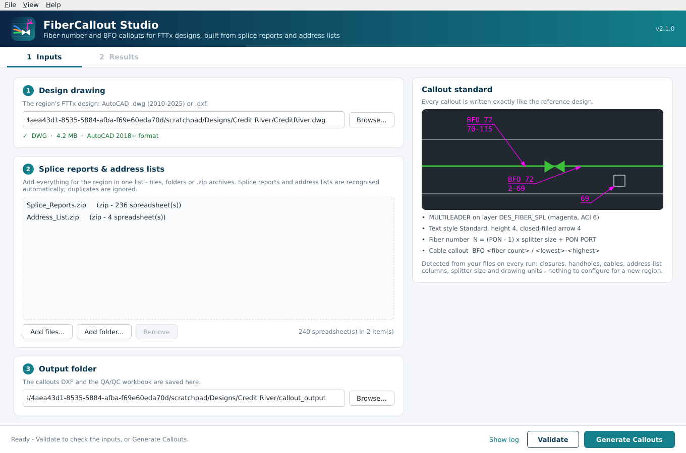
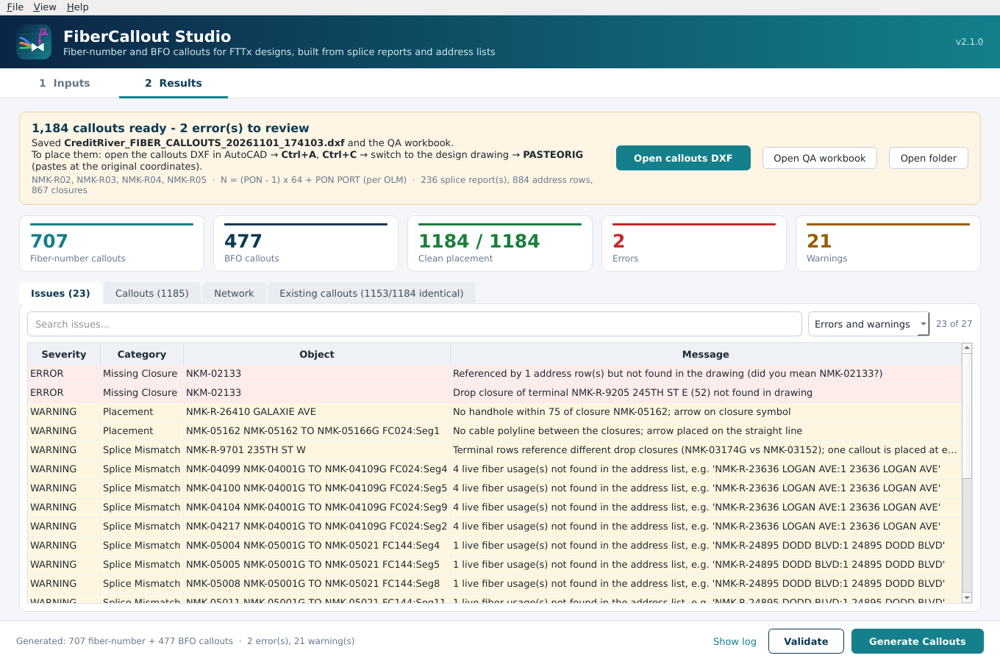

# FiberCallout Studio


FiberCallout Studio is a Windows desktop app. It generates the magenta **DES_FIBER_SPL** fiber-number and BFO callouts
of an FTTx OSP design from the design's **splice reports** and **address lists**, drafted exactly as in the reference
design. It works for any region. The app detects closures, handholes, cables, address-list columns, splitter size and
drawing units from the files on every run, so there is nothing to configure.



## Download and run (Windows)

1. Download **FiberCalloutStudio-windows-x64** from the repository's *Actions* run (artifact) or *Releases* page.
2. Run `FiberCalloutStudio.exe`. You don't need Python, AutoCAD or anything else. The exe isn't code-signed, so if
   Windows SmartScreen appears, click *More info -> Run anyway*.
3. To check the installation, use *Help -> Run self-test* (or run `FiberCalloutStudio.exe --selftest`).

## Workflow

| Step | What to do |
|---|---|
| **1 Inputs** | Pick the design drawing (`.dwg` AutoCAD 2010-2025 or `.dxf`). Add every splice report and address list of the region to the one list: files, folders or `.zip` archives. Drag and drop works anywhere in the window. The output folder defaults to `callout_output` next to the drawing. |
| **Validate** | Optional dry run that lists every problem: missing closures (with "did you mean" hints), splice-report vs address-list mismatches, orphan addresses, missing cable geometry and crowded placements. Nothing is written. |
| **Generate Callouts** | Writes the callouts DXF and the QA/QC workbook and opens **2 Results**. |
| **Paste into the design** | In AutoCAD, open the callouts DXF and press **Ctrl+A** then **Ctrl+C**. Switch to the design drawing and type **PASTEORIG**. Every callout lands at its original coordinates. If the design already has fiber callouts, delete them first. The *Existing callouts* tab compares them with the new ones. |



## What the callouts are

| Callout | Rule (reverse-engineered, see [docs/PHASE1_REVERSE_ENGINEERING.md](docs/PHASE1_REVERSE_ENGINEERING.md)) | Example |
|---|---|---|
| Fiber number | `N = (PON - 1) x splitter size + PON PORT` per OLM. One callout per terminal + drop closure (per contiguous run), with the arrow on the handhole that hosts the drop closure. | `69`, `218-219` |
| BFO (cable) | One callout for every cable segment that leaves a closure with a splice report and carries live fibers: `BFO <segment fiber count>` / `<lowest>-<highest> N` of the live (not broken or spare) fibers on that segment. The arrow sits on the cable near the closure. | `BFO 72` / `70-115` |

Entity properties match the reference:

* `MULTILEADER` on layer `DES_FIBER_SPL` (ACI 6, Continuous), with color, linetype and lineweight ByLayer
* MLEADER style `Standard`, text style `Standard` (txt.shx), text height 4.0, rotation 0
* straight leader, closed-filled arrow 4.0, dogleg 0.36, landing gap 0.09
* left/right attachment 6 (underline top line), top/bottom attachment 9
* MText top-left or top-right, depending on the dogleg side

All override flags are set, so the callouts look the same whatever the target drawing's MLEADER style contains.

## Outputs

* `*_FIBER_CALLOUTS_*.dxf`: the callouts only, at the design drawing's coordinates (DXF R2018).
* `*_FIBER_CALLOUTS_QA_*.xlsx`, with these sheets:
  * **Summary**
  * **Network** (per OLM)
  * **Callouts**: every callout with its text, anchor, coordinates, numbers, source calculation (such as
    `PON 1 port 12 -> (1-1)x64+12 = 12`), source files and placement review flags
  * **Terminals**
  * **Cable Segments**
  * **Validation Issues**
  * **Existing vs Computed**
  * **Settings**

## Command line

```bash
FiberCalloutStudio.exe --cli --drawing design.dwg --splice Splice_Reports.zip --address Address_Lists --out output
```

```bash
FiberCalloutStudio.exe --cli --validate-only --project region.json
```

`--project` reads the paths from a JSON file (see `config.example.json`). The CLI has three diagnostic and override
options:

* `--scan-only` prints what was auto-detected.
* `--ports-per-pon N` overrides the splitter size.
* `--units feet|meters|inches` overrides the drawing units.

## Verified

* **Credit River (4 OLMs, 867 closures, 884 fibers)**, read directly from the original DWG:
  * 1,184 callouts generated, the same count as the reference.
  * 705/708 fiber-number and 450/476 BFO texts are identical to the hand-drafted reference.
  * 698/706 arrows are on the same handhole and 448/452 on the same cable.
  * Every difference traces to a defect in the reference drawing or the input data, and the QA workbook lists each
    one.
* **Synthetic region** (`--selftest`, runs on every build): checks every callout's text, anchor and properties on a
  network with:
  * different prefixes, layers, blocks, attribute tags and column names
  * 1x32 splitters and rotated rectangular handholes
  * both splice-report layouts
  * a closure named only by a text label, and one located only from splice-report coordinates
  * commercial `C-` usages, a non-contiguous terminal and a closure typo

## Build from source

```bash
pip install -r requirements-build.txt
```

```bash
python tests/run_tests.py
```

```bash
pyinstaller packaging/FiberCalloutStudio.spec --noconfirm
```

The GitHub Actions workflow `.github/workflows/fiber-callout-studio.yml` does this on `windows-latest`. It runs the
tests, self-tests the built exe and uploads it. To create a pre-release, run the workflow manually with
*publish_release*.

## Layout

```
fiber_callout_studio.py   entry point (GUI / CLI / self-test)
fcs/engine.py             inputs, network model, callout rules, placement, DXF writer, QA workbook
fcs/dwg_native.py         built-in DWG 2010-2025 reader
fcs/gui.py                PyQt6 interface          fcs/branding.py  logo
fcs/selftest.py           synthetic-region generator + verification
tests/run_tests.py        unit tests + self-test
packaging/                PyInstaller spec, Windows version info, release notes
docs/                     Phase 1 reverse-engineering report, screenshots
analysis/                 original analysis decoder used for the reverse-engineering
```
