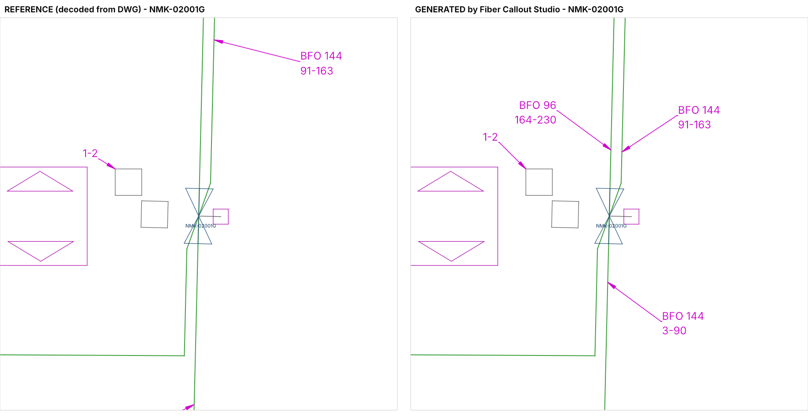
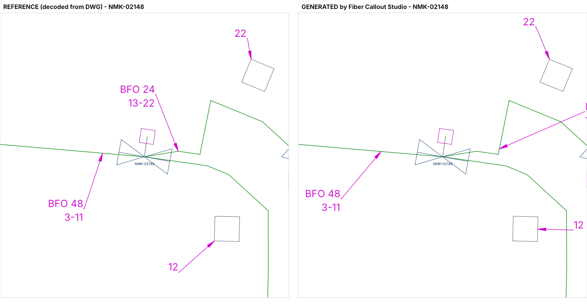

# Phase 1 — Reverse-Engineering of the DES_FIBER_SPL Fiber-Number Callouts

**Reference drawing:** `386106_Credit_River_MN_FTTH_Combined_DWG.dwg` (AC1032 / AutoCAD 2018 format)
**Splice reports:** 236 workbooks (NMK-R02 51, R03 62, R04 69, R05 54)
**Address lists:** 4 workbooks (one per OLM: NMK-R02 … NMK-R05)

Every number below was measured on the actual files (the DWG was decoded object-by-object — see
[How the DWG was read](#how-the-dwg-was-read)); nothing is assumed from convention.

---

## 1. Inventory

| Item | Value |
|---|---|
| DWG version | AC1032 (R2018), produced with SPATIALnet + AutoCAD Map (`SNET_DICT`, `AcMap*` classes) |
| Objects / model+block entities | 75,452 objects / 65,137 entities, 93 layers |
| Text styles | `Standard` (txt), `SIMPLEX` (simplex.shx), `VER` (verdana.ttf) |
| MLEADER styles | `Standard` (only one) |
| OLM housings (`CX1_OLM`) | 4 — NMK-R02 … NMK-R05 (the 5th design unit is the New Market OTN transport hub, `CX1_OTN_MC`, which carries no PON numbering) |
| Splice closures (`MC_SPLICE.dwg`, layer `Fiber Splice`) | 867, each with attribute `NAME` |
| Terminals (`CX1_MDU_ENCLOSURE`, layer `Fiber Node`) | 708 (no name attribute) |
| Handholes (`CX1-MAX5` 593 + `CX1-MAX10` 260, layer `RTE_UGPOLES`) | 853 |
| Cable linework | 888 `Fiber Cable - Underground`, 29 `Fiber Cable - Aerial`, 705 `Fiber Cable - Pigtail` LWPOLYLINEs |
| Address-list rows | 1,384 total, **884 PON-assigned**, 707 terminals (708 terminal/closure groups) |
| Splice reports | 233 "Splice Connections Report" + 3 "Fiber Optic Splice Guide" layouts; 790 segments, 16,309 fiber connections |

### Key structural finding

* **There is no layer named "Fiber Number" in the drawing.** The 93-layer table was decoded in full.
* **`DES_FIBER_SPL` contains exactly 1,184 entities, all `MULTILEADER`** (model space) — no TEXT/MTEXT/INSERT.
  The "fiber numbers" are the MText content of these multileaders. Two families exist:

| Family | Count | Text pattern | Meaning |
|---|---|---|---|
| Terminal ("fiber number") | 708 | `N` (539) or `Nmin-Nmax` (169) | Fiber numbers delivered to one terminal |
| Cable ("BFO") | 476 | `BFO <count>\P<Nmin>-<Nmax>` | Fiber-count of a cable segment + span of fiber numbers it carries |

---

## 2. Callout derivation logic (proven)

### 2.1 Fiber number

```
N = (PON NAME − 1) × 64 + PON PORT            (numbered independently per OLM)
```

* 64 = output count of the `PLC COUPLER 64` splitters listed in every hub splice report (`FE0-F1PLC64`, 65 = 64 + COM).
* Proof: NMK-R02 has PON 1–3 fully used (64 ports) and PON 4 ports 1–38 → 3×64+38 = **230**, which is exactly the
  largest number on NMK-R02's callouts (`BFO 96\P164-230`). The same holds for R03/R04/R05.
* `FIBER #` (position in the first feeder cable) is **not** the callout number — e.g. PON 1 port 3 is fiber 13 of
  `NMK-02001G TO NMK-02132 FC144` but its callout number is 3.
* Rows without a PON (transport, spares, `PLC COUPLER … COM`, `Spare (dark)`) never receive a number.

### 2.2 Terminal ("fiber number") callouts — Address List driven

* Group PON-assigned address rows by **terminal (`Fiber Tap Name`) and drop closure (`Fiber Splice`)**.
* Text = the group's numbers; one callout per contiguous run (`N` or `Nmin-Nmax`).
* Verification against the DWG: **705 / 708** callouts equal the complete number set of exactly one terminal at
  exactly one drop closure (0 orphan numbers). The 3 others:
  * `21` and `23` — one terminal whose two addresses are dropped at **two different closures**
    (address list) → drafted as two callouts. This defines the rule "split by drop closure / contiguous run".
  * `109` — terminal holds 109 and 110 → drafting error in the reference (tool writes `109-110`).
* 6 R05 callouts are zero-padded (`03`, `08-09`); all others are unpadded → standard = no padding (configurable).

### 2.3 Cable ("BFO") callouts — Splice Report driven

```
For every splice report (closure S) and every cable segment whose Start Splice = S
(non-pigtail) and that carries ≥ 1 live fiber:
    text = "BFO " + <segment fiber count> + "\P" + <min N> + "-" + <max N>
```

* *Live* = connection rows on that segment whose `State` is not Broken / Spare (dark), resolved to an address-list
  row through the `Usage` column (`<terminal>:<k> <address>`). `<terminal>:<k>` is the k-th fiber of the terminal,
  which also resolves commercial (`C-` prefixed) and unit-number spelling differences.
* The range is a **span (min-max)**, not a list: e.g. a feeder carrying 3–63 and 65–90 is labelled `BFO 144\P3-90`.
* `<count>` = segment `Count` column (= `FCnnn` of the cable name).
* Labelled vs. unlabelled segments in the DWG: 451 of 467 segments leaving a closure **with** a splice report carry
  a BFO label; 121 of 129 segments leaving closures **without** a report carry none → the drafter generated BFO labels
  from the splice reports.
* Verification: **450 / 476** BFO callouts are reproduced character-for-character at the same cable segment.
  The 26 others are reference-vs-report discrepancies (off-by-one range ends where the DWG pre-dates the current
  reports, a 5-segment FC096 chain whose labels are shifted by one segment, and segments carrying fibers for two
  addresses that are missing from the address lists). All are listed in the QA workbook (`Existing vs Computed`).

---

## 3. Spatial & topological association

There is **no data link** between a callout and the network: no XData, no extension dictionary, no reactors, no
groups, no field codes on any of the 1,184 multileaders, closures or cables (all decoded). The association is
purely geometric:

| Callout | Arrowhead (leader vertex) lies on | Measured |
|---|---|---|
| Terminal | the boundary of the 12 × 12 handhole block (`CX1-MAX5` / `CX1-MAX10`, block extents ±6.0) hosting the drop closure | 393 on a corner (local ±6,±6), the rest on an edge; median 6.0 / 8.49 (=6√2) from the handhole insert; 698 / 706 on the same handhole the tool selects |
| BFO | the cable polyline of the segment, near the upstream closure | perpendicular distance 0.0 (median); 31 ft median from the closure; 407 / 459 on the upstream half; 448 / 452 on the same polyline the tool selects |

Drafting offsets in this design: closure symbol ≈ 20 ft from its handhole, terminal symbol ≈ 30 ft
(connected to the closure by a `Fiber Cable - Pigtail` polyline).

### Leader geometry (identical on all 1,184)

* 1 leader, 1 leader line, 1 vertex (the arrowhead point), straight segment to the landing point.
* Dogleg along ±X only; **dogleg direction = sign of the leader's X direction** (1,182 / 1,184).
* MText insertion = `landing + dogleg·(0.36 + 0.09) + (0, 1.2·height)` (0 exceptions).
* MText attachment: top-left (1) for a +X dogleg, top-right (3) for a −X dogleg (1,074 / 1,184).
* Leader length (arrow → landing): median 16–17 (terminal), 30 (BFO).

---

## 4. Exact CAD entity specification

| Property | Value | DXF group / object |
|---|---|---|
| Entity type | `MULTILEADER` (AcDbMLeader, class version 2), content type **MText** | 0 / 270 / 172 = 2 |
| Layer | `DES_FIBER_SPL` | 8 |
| Layer color / linetype / lineweight | **ACI 6** (magenta) / Continuous / Default, plottable | LAYER 62 / 6 / 370 |
| Entity color / linetype / lineweight | ByLayer / ByLayer / ByLayer | 62 = 256 / 6 / 370 = −1 |
| MLEADER style | `Standard` | 340 |
| Leader type / color / linetype / lineweight | straight / ByLayer / **ByBlock** / ByBlock | 170 = 1 / 91 / 341 / 171 = −2 |
| Arrowhead / size | default closed-filled / **4.0** | 342 (none) / 42, ctx 140 |
| Landing / dogleg / dogleg length / landing gap | on / on / **0.36** / **0.09** | 290 / 291 / 41 / ctx 145 |
| Text style → font | `Standard` → **txt** (txt.shx), width factor 1.0, oblique 0 | 343 → STYLE 3 / 41 / 50 |
| Text height / rotation | **4.0** / 0° | ctx 41 / 42 |
| Text color | ByLayer (entity), ByBlock (MText context) | 92 / ctx 90 |
| Left / right attachment | **6 / 6** (bottom of top line, underline) | 173 / 95, ctx 174 / 175 |
| Top / bottom attachment | **9 / 9** | 273 / 272 |
| Attachment direction | horizontal | 271 = 0 |
| Text angle type / alignment type | 1 / 2 | 174 / 175 |
| Text attachment point | 1 (+X dogleg) / 3 (−X dogleg) | 179 |
| Context text-align | 0 (+X) / 2 (−X) | ctx 176 |
| MText alignment / flow / line spacing | 1 or 3 / left-to-right / 1.0 "at least" | ctx 171 / 172 / 45, 170 |
| Background mask / frame / annotative / scale | off / off / no / 1.0 | 291–292 / 292 / 293 / 45 |
| Paragraph separator | `\P` (reference mixes `\P` and raw LF; tool writes `\P`) | 304 |

**Variant:** 160 of the R05 terminal callouts were drafted at height 5.0 (left attachment 1, flow 5, ByBlock
background). The majority standard (height 4.0, 1,024 callouts) is the tool default; all values are editable.

---

## 5. How the DWG was read

`ezdxf` cannot read DWG and installing third-party DWG converters was not possible in the analysis environment, so
a read-only R2004+ DWG decoder was written from the Open Design Specification (`analysis/`):

* container: encrypted file header, page map, section map, LZ77 page decompression;
* object map (`AcDb:Handles`), class map (`AcDb:Classes`), R2007+ string streams;
* bit-level decoders for LAYER, STYLE, LTYPE, BLOCK_HEADER, APPID, DICTIONARY, TEXT, ATTRIB, ATTDEF, MTEXT, INSERT,
  LWPOLYLINE, LINE, LEADER and **MULTILEADER** (full AnnotContext).

Decoding is bit-exact: after each TEXT (928), ATTRIB (39,843) and MULTILEADER (1,185) the decoder ends at exactly
bit 0 of the object's string stream, i.e. every field was consumed with the correct width.

---

## 6. Validation of the production tool against the reference

Version 2.0 reads the original DWG directly (built-in reader) and auto-detects all mappings from the raw ZIP inputs;
the same figures are obtained from a DXF rebuild of the network:

| Check | Result |
|---|---|
| Callouts generated | 707 terminal + 477 BFO = 1,184 (reference 1,184) |
| Terminal callout text identical to reference | 705 / 708 (2 drafting errors in the reference + 1 address-list closure typo `NKM-02133`) |
| Terminal callouts on the same handhole as reference | 698 / 706 |
| BFO text identical to reference | 450 / 476 (reference-vs-report discrepancies, see §2.3) |
| BFO callouts on the same cable polyline | 448 / 452 |
| Entity / style / layer properties | 100 % per §4; text-location rule 0 violations |
| Placement QA (tool vs. reference, same metric) | 1,184 clean vs. 1,184 clean (0 text/text, 0 text/symbol overlaps, 0 leader crossings) |
| Output DXF audit (ezdxf) | 0 errors |
| Run time (full Credit River) | ≈ 10 s from the original DWG (built-in reader), ≈ 12 s from the packaged exe |




### Data issues found by the pre-flight validation (real defects in the inputs)

* Address list references closure **`NKM-02133`** (typo for NMK-02133) → that terminal cannot be placed.
* One terminal has its two addresses dropped at two different closures.
* Live fibers in the splice reports for two terminals (R04, R05) that do not exist in the address lists.
* Closure NMK-05162 has no handhole within 75 ft (terminal callout anchored on the closure symbol) and its segment
  to NMK-05166G has no cable polyline between the closures (BFO callout placed on the chord). Both are flagged.
